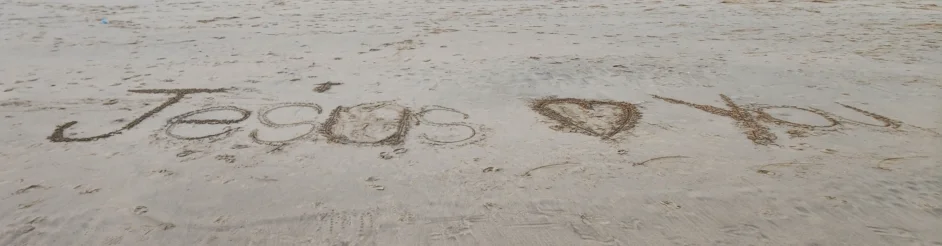

# About

As a Trinitarian Christian, I was challenged to prove that the [Trinity](trinity.md) is sound biblical doctrine. Initially, I thought this would be a quick, easy task. After all, it is foundational to the faith of most [Christian churches](https://church.ofgod.info). However, after months of frustration, I had to admit that the Trinity doctrine is not biblical, but a [later theology based on Greco-Roman philosophy](trinity/development.md).

Some of my Christians friends argued that is not an important matter and those debates should be left to the theological scholars. While it is true that [understanding the Trinity is not a salvation issue](shema/concerns/salvation.md), an important question remains:

*[How could Jesus be God](divine.md)?*

Jesus died, yet God is immortal. Jesus did not know everything, yet God is omniscient. Jesus left and will return, yet God is omnipresent. Theologians subscribe to the Chalcedonian declaration that Jesus had [two natures](dual-nature.md): divine and human. Yet they hold that there was only one Jesus, not two persons. This complex explanation looks convincing on paper, but it is hard to explain without philosophical terms. No biblical author mentions a [dual nature](dual-nature.md), and [the biblical evidence](divine/texts.md) is weak.

## Why Jesus "Must" Be God

Without a divine Jesus, how does one resolve [concerns](shema/concerns.md), like:

- [How can 1 ordinary man pay the price of sin?](shema/concerns/price.md)
- I was taught by [the church](https://church.ofgod.info) that faith means "[to blindly accept Jesus is your God](shema/concerns/salvation.md)". Any questioning would constitute [blasphemy](shema/concerns/blasphemy.md), because we should not dare to reduce God to a human.

## My Crisis

It is undeniably clear that the Son is [not the same person](human/distinct.md) as the Father. Yet the biblical [evidence for a single God](shema.md) is solid and even directly confirmed by a scribe and Jesus himself (Mark 12:28-32). It would be a contradiction to have 2 competing gods. Without applying [latter philosophy](trinity/development.md), how does one resolve this tension?

## My Testimony

I did not want to risk committing the [unforgivable sin](shema/concerns/unforgivable-sin.md) or [worship](shema/concerns/worship.md) the wrong God. After all the [Majority](shema/concerns/majority.md) of Christians have believed for thousands of years that Jesus is God. [How could they all be wrong?](shema/concerns/majority.md)

Walking on the beach I wrestled with these issues and physically cried out to God for help. My greatest concern was that I do not want to deny Jesus, because he said himself that only those [known by him](shema/concerns/known-by-jesus.md) shall "enter [the Kingdom](https://kingdom.ofgod.info) of ***[Heaven](https://word.ofgod.info/terms/heaven)***". Suddenly I felt a great prompt to stop and turn left. I know it was not my own imagination. As I turned left, I saw this:

This was my "Damascus" life changing moment. I understood that Jesus did not reject me despite my doubts and concerns. For the first time I had Jesus' permission to freely search the Scriptures even if it means that it could proof that [he is not God](human/has-a-god.md).

With that obstacle out of my way, I was able to research this subject freely without fear. This website is the fruit of that project and it is still an ongoing exploration. I'm still learning, still discovering new depths in familiar passages, and still amazed by how much there is to understand about [our Father God](https://ofgod.info) and His [son](https://son.ofgod.info) Jesus who is our Lord [Christ](https://kingdom.ofgod.info/christ).

## The Heart Behind This Website

I found that many Christians [mix up the Father and the Son](divine/similarities.md) which breaks down the credibility of the Gospel. My intention is to draw a clear [distinction](human/distinct.md) between **God the Father** and **the Son of God**. I have no intention to [blaspheme](shema/concerns/blasphemy.md) God or to [uncrown the Lord Jesus](shema/concerns.md), but instead to **[glorify both](shema/benefits.md) in their rightful positions**.

## The Purpose: Back to Basics

This website exists to help Christians distinguish manmade tradition from biblical truth so that we know:

1. **How to worship God correctly** — recognizing the Father in His proper position
2. **How to obey (follow) Christ correctly** — recognizing the Son in his unique role as Lord and Christ
3. **How to argue and defend the faith correctly** — recognizing the distinctions between the Father, the Son, and the Holy Spirit

By returning to the biblical foundations, we can resolve the [myterious](https://church.ofgod.info/terms/mystery) confusion and gain clarity on passages that seem contradictory when the Father, Son, and Holy Spirit are not properly distinguished.

You'll find here careful attention to biblical texts, exploration of themes that address these distinctions, and honest wrestling with questions that many of us have wondered about.

## Full Transparency

I write independently, not affiliated with any church or organization, and without sponsorship. This freedom allows me to follow where God's word leads without institutional constraints.

I encourage you to critically evaluate everything you read. Not just on this website, but always pray about any Christian content from any source you receive. I admit that I have been [wrong before](disclaimer.md), and I'll likely make more mistakes. That's why I genuinely invite you to [correct my errors](edit.md) when you spot them. Your wisdom, your insights, and your questions make this a richer resource for everyone who visits.

## An Invitation to Explore

Some topics might be unfamiliar. Some interpretations might differ from what you were used to. That's part of the journey toward clarity.

Rather than asking you to accept my conclusions, I invite you to examine the Bible for yourself. The content here is designed to point you back to God's word, to raise questions worth pondering, and to provide tools for your own bible study.

As you explore this site, I encourage you to:

- Test everything against the Scripture (Acts 17:11)
- Ask the Father to reveal through His Spirit the truth of [His word](https://word.ofgod.info)
- Share what you discover with others

Whether you read one article or explore the entire site, my prayer is that it draws you closer to God's love and your position in His eternal [Kingdom](https://kingdom.ofgod.info).
